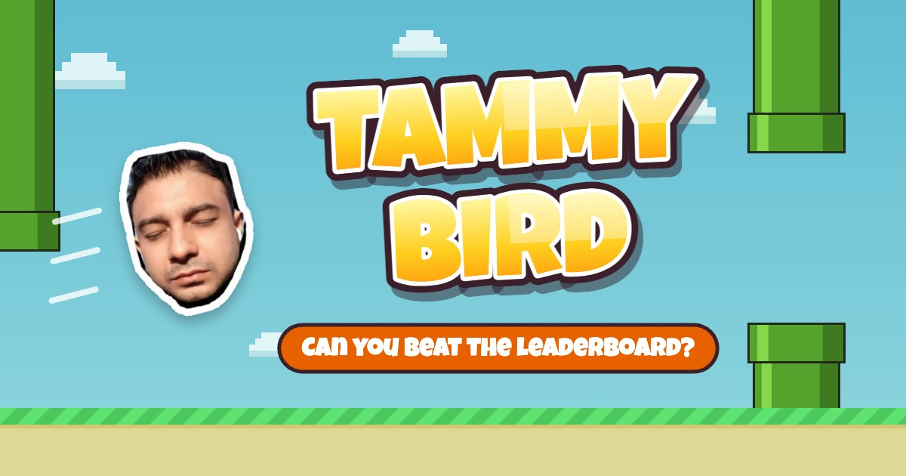

# Tammy Bird



A Flappy Bird–style browser game starring Tammy's face. Flap through the pipes, earn medals, and get your name on the global leaderboard.

Built with plain JavaScript and HTML Canvas (no framework), bundled with [Vite](https://vitejs.dev), and deployed on [Vercel](https://vercel.com) with an [Upstash Redis](https://upstash.com) leaderboard.

## How to play

| Action | Desktop | Mobile |
| --- | --- | --- |
| Flap | <kbd>Space</kbd> / <kbd>↑</kbd> / click | Tap |
| Mute / unmute | <kbd>M</kbd> or 🔊 button | 🔊 button |
| Leaderboard | 🏆 button | 🏆 button |
| Close dialog | <kbd>Esc</kbd> | Close button |

- Each pipe you pass is 1 point. The game speeds up and the gaps tighten until score 50.
- Medals: 🥉 Bronze 10 · 🥈 Silver 20 · 🥇 Gold 30 · 💎 Platinum 40
- Make the global top 10 and you'll be asked for your name. Each name keeps its best score.

## Features

- Smooth, frame-rate–independent physics (same feel at 60 Hz and 120 Hz)
- Synthesized sound effects via Web Audio, no audio files: the "ummm" flap, point ding, crash
- Parallax background (clouds, skyline, bushes), squash-and-stretch, score pop, screen shake
- Personal best saved in the browser; global top-10 leaderboard via a serverless API
- Scales to any screen; sharp rendering on high-DPI displays
- Social share card (Open Graph / Twitter) with a custom banner

## Project structure

```
├── index.html            # Page shell, canvas, leaderboard dialog, share-card meta tags
├── src/
│   ├── main.js           # Game loop, physics, pipes, collisions, rendering, input
│   ├── audio.js          # Synthesized sound effects + mute
│   ├── leaderboard.js    # Leaderboard API client and dialog UI
│   └── style.css         # Layout and dialog styles
├── api/
│   └── leaderboard.js    # Vercel serverless function: GET top 10, POST a score
├── public/
│   ├── face.png          # Player sprite (also the favicon)
│   └── og.jpg            # 1200×630 share image
└── vite.config.js        # Runs /api locally during dev; sets the share-image URL on Vercel
```

## Run locally

Requires Node.js 18+.

```bash
npm install
npm run dev
```

Open http://localhost:5173. The leaderboard API runs inside the Vite dev server and keeps scores **in memory** (reset when the server restarts), so no database is needed for local development.

To use the real database locally, pull the Vercel environment variables first (`vercel env pull .env.local`) and restart `npm run dev`.

Production build:

```bash
npm run build     # outputs to dist/
npm run preview   # serves the build (static only, no /api)
```

## Deploy to Vercel

1. Import this repository in Vercel (**Add New → Project**). The Vite preset is detected automatically; no settings to change.
2. Add the leaderboard database: in the project, go to **Storage → Create Database → Upstash Redis** and connect it to the project. This adds the connection environment variables. Any of the naming styles Vercel uses works, including a custom prefix (e.g. `UPSTASH_REDIS_REST_KV_REST_API_URL` / `..._KV_REST_API_TOKEN`).
3. Redeploy. Without the database, the game still works but the leaderboard shows "Couldn't load the leaderboard."

## Leaderboard API

`GET /api/leaderboard` returns the top 10:

```json
{ "entries": [{ "name": "Saad", "score": 42 }] }
```

`POST /api/leaderboard` with `{ "name": "Saad", "score": 42 }` submits a score and returns the updated top 10.

- Names are trimmed, stripped of control characters, and capped at 16 characters.
- Scores must be whole numbers from 1 to 9999.
- Each name keeps only its highest score (Redis `ZADD GT`). The set is capped at 1000 entries.

> **Note:** scores are reported by the browser, so a determined player could submit a fake score with dev tools. This is normal for casual web games. If it becomes a problem, entries can be removed directly in the Upstash console (`ZREM leaderboard "<name>"`).

## Tuning

Gameplay constants live at the top of `src/main.js`:

| Constant | Default | What it does |
| --- | --- | --- |
| `GRAVITY` | 1400 | How fast the face falls |
| `FLAP_VELOCITY` | -420 | Strength of each flap |
| `SPEED_START` / `SPEED_MAX` | 120 / 160 | Scroll speed at the start / at max difficulty |
| `GAP_START` / `GAP_MIN` | 125 / 100 | Pipe opening at the start / at max difficulty |
| `RAMP_SCORE` | 50 | Score at which difficulty maxes out |
| `PIPE_SPACING` | 200 | Horizontal distance between pipes |
| `FACE_H` | 46 | Face size on screen |
| `bird.radius` | 16 | Collision radius (smaller = more forgiving) |
